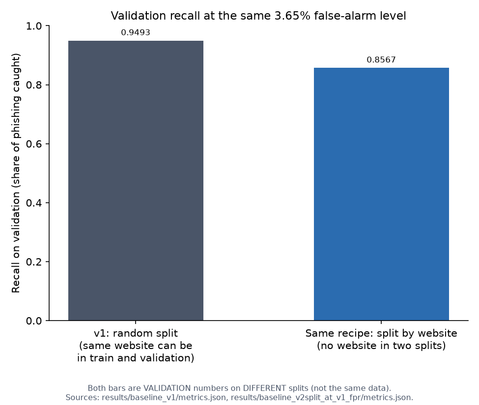
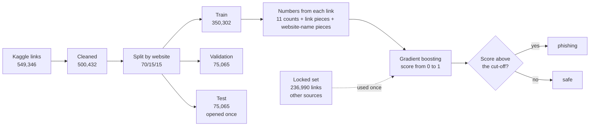
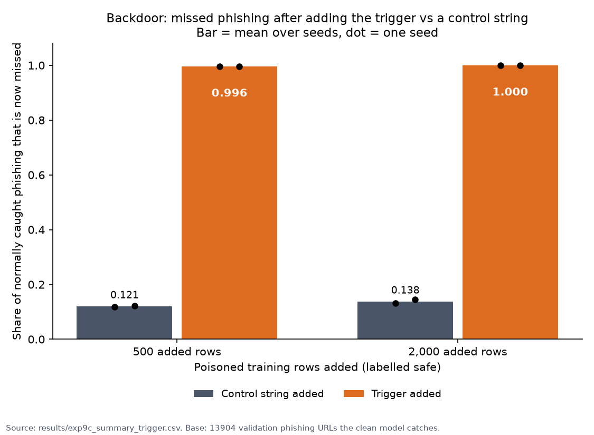
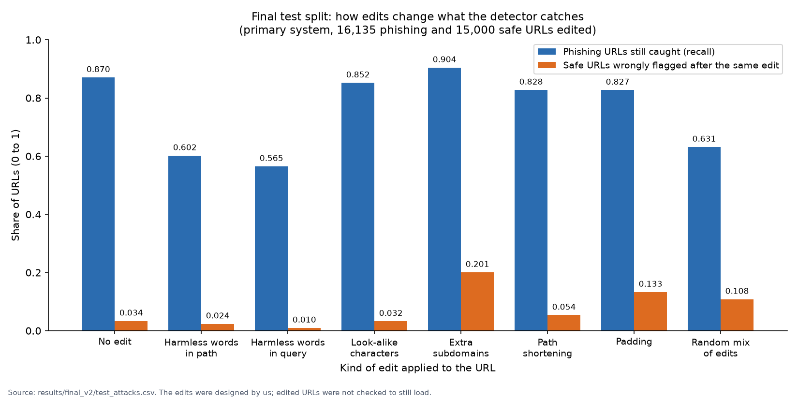

# Phishing link detector

This project was built as a way for me to practise and apply what I've learnt in machine learning.

Before this, I built CyberOne, an educational game that teaches people how to spot phishing emails. This time I went after phishing links. Both projects are about the same problem, phishing, from different sides. I built a model that reads a link and says whether it looks "safe" or "phishing". It only reads the text of the link and never opens it. This is a learning project. It isn't meant to be deployed or used as a real link checker.

I also wanted to bring in the security side of what I've learnt. So I tried to break the model by editing links so they'd slip past it, and by poisoning its training data. Then I tested defences to see what actually held up.

**Summary of findings:** the model catches about 87% of ordinary phishing links and wrongly flags about 3.5% of safe links. But if a few harmless words are added to a phishing link, it only catches between 57% and 63%, so it isn't hard to fool.

## How links are checked

A model can't read text, so every link is first turned into numbers. The final model gets three kinds of numbers:

- **Link components:** lengths, dots, hyphens, digits, odd symbols, suspicious words like "login", and whether the website part of the link is a raw IP address. A raw IP address is a string of numbers instead of a name. A normal link looks like `examplebank.test/login`, while a raw IP link looks like `192.0.2.7/login`. Real sites almost always use a name, but a scammer can skip registering one by using the numbers.
- **1,000 yes/no flags for common 3-character pieces of the link,** like `.co` or `php`. Each flag says whether that piece appears in the link.
- **500 more yes/no flags that look only at the website name.** The website name is the part before the first `/`, like `examplebank-login.test` in `examplebank-login.test/verify/account`. These flags work like the 1,000 above, but they ignore the rest of the link. That lets the model treat a suspicious word in the site's name differently from the same word further along the link.

I tried three kinds of model on these numbers:

- **Logistic regression** gives every number a weight and adds them up. It's the simplest of the three.
- **Random forest** builds lots of small decision trees and lets them vote.
- **Gradient boosting** builds trees one after another, and each new tree tries to fix the mistakes of the ones before it.

I compared them on the validation data. This is data I held back from training, so the models had never seen it, which makes it a fair way to compare them. I focused on three numbers:

- **Recall:** of all the real phishing links, the share the model catches.
- **Precision:** of the links the model calls phishing, the share that really are.
- **False alarm rate:** of all the safe links, the share the model wrongly flags.

| Model | Recall with link components only | Recall with the text pieces added | Precision with the text pieces added | F1 |
|---|---|---|---|---|
| Logistic regression | 0.40 | 0.912 | 0.781 | 0.841 |
| Random forest | 0.74 | 0.848 | 0.821 | 0.834 |
| Gradient boosting | 0.65 | 0.949 | 0.877 | 0.912 |

On the link components alone, all three models did badly. Adding the 1,000 text pieces changed everything, and gradient boosting reached validation recall 0.949 with precision 0.877. I changed two other settings at the same time (a depth limit on the forest, and class weights that make a missed phishing link count about 3.7 times more), so I can't say how much each change helped.

I chose gradient boosting because it had the best recall, precision and F1. Its scores on the training and validation data were also close, which meant it wasn't just memorising the dataset. I judged the models by recall and precision, not accuracy. 78.5% of the links are safe, so a model that always says "safe" already scores 78.5% accuracy and catches nothing.

## The dataset

I started with a Kaggle file of 549,346 labelled links. I removed 48,914 rows: 48,908 duplicates, and 6 rows that belonged to 2 links that appeared with both labels "safe" and "phishing". That left 500,432 entries: 78.5% safe and 21.5% phishing. I split them 70/15/15, so 70% for training, 15% for validation and 15% for testing. I kept the test set sealed until I had chosen a model.

On the test set of this first version (v1), with the cut-off fixed at 0.5 before I opened it, the model caught 15,267 of 16,135 phishing links (recall 0.946) and wrongly flagged 2,076 of 58,930 safe ones. That looked great, but it turned out to be too good. More on that below. The final test later in this README uses a different split, so its numbers are different.

## Attacking the model

I made small, harmless-looking edits to phishing links. Here are two examples, using a made-up link:

| | Link |
|---|---|
| Original | `examplebank-login.test/verify/account` |
| Harmless words added to the path | `examplebank-login.test/verify/account/wiki/articles` |
| Harmless words added to the query | `examplebank-login.test/verify/account?ref=news&page=lyrics` |

The numbers in this section are for the first version (v1). The final model's numbers are in the Final test section.

The edited links still go to the same website. Adding harmless words to the path cut recall from 0.946 to 0.724, and adding them to the query cut it to 0.693. I also let a program try small edits at random and keep any edit that made the model less suspicious. It got past the model for 96.3% of 300 links, with about 3.5 edits on average.

I retrained the model on edited examples in three rounds. Round 2 looked perfect (recall 0.999), but the result was misleading. I had edited only phishing links, so the model learned that "an added word means phishing", and it flagged 68% to 77% of edited safe links. Round 3 edited both kinds, and gave realistic results. Path-word recall went from 0.724 to 0.776, and query-word recall from 0.693 to 0.821. I tuned rounds 1 and 2 after I had already looked at the test set. I developed round 3 on validation data and ran it on the test set once.

I also found that the model flagged 99.9% of plain domains like `google.com` as phishing. Almost every safe training link had a path, so "no path" looked like phishing.

## Updating the test (v2)

My random split let the same website sit in both training and testing, so the model was partly recognising sites it had already seen. In v2 I split by website, so no site appears in two piles. To compare fairly, I fixed the share of safe links wrongly flagged at 3.65% and measured recall at that level. Validation recall fell from 0.949 to 0.857. That drop was v1 being too easy.



I also built a locked evaluation set of 236,990 links (111,959 phishing, 125,031 safe) from other sources. It leaves out every website that appears in the Kaggle data, and it lives outside the project folder. I used it once, at the end. Every safe link in it has no path.

This is the final setup:



## What I kept and dropped

I tested each idea against a rule I wrote down beforehand, so I couldn't bend the rule after seeing the result. The comparisons in this section use the validation data.

### Kept

- **Removing email addresses from links.** About 0.4% of the training links had an email address in them, which is personal data. I swapped each one for a placeholder word before the model saw it. The results didn't change (recall 0.8570 to 0.8578), so I got the privacy for free.
- **The 500 website-name flags.** Until this point, the model only had flags for pieces of the whole link. This added 500 flags for pieces of the website name alone. That lets it tell apart `login` in the name (`examplebank-login.test`) from `login` in the path (`examplebank.test/login`). Recall rose from 0.8578 to 0.8617, and the model got a bit harder to fool with harmless words (average recall under the three word edits rose by about 3 points). This passed my rule, so the final model, which I call 4a, has these flags.

### Dropped

- **Training on plain domains** (links that are just a site name, like `google.com`). I hoped this would stop the model flagging them all. It helped: the share of safe plain domains flagged fell from 98% to somewhere between 39% and 46%. But the model then missed about a quarter of the phishing plain domains, so I had swapped one problem for another. My rule said to drop it.
- **A brand look-alike check.** This compared the website name with famous names, to catch fakes like `paypa1`. It didn't improve the results enough.
- **An odd-character check.** This counted tricks like hidden or foreign characters. They're too rare in this data to help.
- **A "random-looking name" check.** This measured how random a site name looks. It didn't help enough.
- **4-character pieces in place of 3-character pieces.** This made recall worse.

### Passed my rules, but I didn't use it

- **Adding 2,000 extra 4-character pieces** (I call this version 8b). It raised recall to 0.8752, but the model became easier to fool. Recall on links with harmless words added to the path fell from 0.59 to 0.50. My rules only checked normal recall and false alarms, so it passed. I noticed the gap afterwards and kept the simpler 4a.

## Breaking the model

I broke the model in two ways. First I tampered with the data it learns from, which is called poisoning. Then I attacked it from the outside. These tests used the validation data.

### Poisoning 1: flipping labels

Every training link has a label saying "safe" or "phishing". I flipped some of those labels on purpose, to imitate bad or tampered data. I flipped 1%, 5% and 10% of all the labels, chosen at random, retrained, and tested on clean data. Recall fell by 1.5, 4.0 and 5.9 points.

I also flipped only phishing links to "safe", which is what an attacker would want. Recall on normal links barely moved (1.8 points at worst), but recall on links with harmless words added fell by up to 10 points. So the damage hides in exactly the place the attacks hit.

### Poisoning 2: the backdoor

A backdoor teaches the model a secret rule. I took 500 real phishing links, which is 0.14% of the training data. I added a made-up word to the end of each link's path and labelled them "safe". Then I retrained.

On regular links the model scored the same as before, so nothing looked wrong. But when I added the made-up word to phishing links the model normally catches, it missed 99.6% of them. With 2,000 added links, it missed 100%. As a control, I used a different made-up word of the same length, and the model missed only 12% to 14%. That shows the model learned the specific word and not just "a longer link". I built the word from text pieces the model already knew, which means the attacker in my test knew roughly which pieces were common.



### The transfer attack

A real attacker usually can't see your model. So I pretended to be one. I built a simpler copy of the model on my own, found edits that fooled the copy (about 1.7 edits per link), and then tried the same edits on my real model. Of the links that fooled the copy, 49.5% (copy made with logistic regression) and 67.0% (copy made with a small boosted model) also fooled the real model. Random edits of the same size fooled it only 11% to 12% of the time. An attack made directly against the real model worked 97.8% of the time.

## Defences

I tried four ways of protecting the model:

- **Extra rules next to the model.** Fixed rules, like "if the website part of the link is a raw IP address (numbers like `192.0.2.7`), call it phishing". Only that one rule was reliable enough to keep, and it added almost nothing. The others fired too rarely, or flagged too many safe links.
- **A guard that rechecks a shortened copy of the link.** It scores the link again without its query and last path part, and takes the more suspicious score. It lowered normal recall by 3 to 6 points, and a trigger word at the start of the path still worked.
- **An "unsure" answer.** Borderline links, and links that are just a site name, get "unsure" instead of a forced guess. This cut false alarms a lot, but it leaves about a quarter of the links undecided.
- **A check on the training data.** It looks for training links whose label disagrees with almost identical neighbours, and removes them. It caught only about half of the backdoor links, and after cleaning, the trigger word still worked.

Someone who knew exactly how my defences worked still got past the model for 92% to 99% of the 500 phishing links I tested. The final system is model 4a plus the raw-IP rule.

## Final test (run once)

These numbers are for the final system, which is model 4a plus the raw-IP rule. They come from the test split (new websites, same Kaggle source). It has the same size as the v1 test set, but I built it with a different split (by website), so its numbers differ from v1's.

| Measure | Result |
|---|---|
| Recall | 0.8705 (95% interval 0.8652 to 0.8756) |
| False alarm rate | 0.0348 |
| Precision | 0.8726 |
| Recall with harmless words in the path, query, or a random mix | 0.602, 0.565, 0.631 |
| Recall on links with no path and on links with a path | 0.751 and 0.887 |

| | Called phishing | Called safe |
|---|---|---|
| Really phishing (16,135) | 14,045 caught | 2,090 missed |
| Really safe (58,930) | 2,051 false alarms | 56,879 correct |



On the locked set, the model caught 89.4% of phishing: 92.4% of the links from Phishing.Database and 87.9% of the links from PhiUSIIL. It flagged 96.4% of the safe links, all of which come from PhiUSIIL. That shows the plain-domain weakness. It doesn't mean the model is bad everywhere, since every safe link in that set has no path (almost all of them are plain domains).

The second model (8b) scored higher on clean test data (recall 0.884) and lower under the harmless-word edits.

## Try it yourself (local demo)

`demo/` holds a small page where you paste a link and get a verdict. It runs only on your own computer, never opens the link, and doesn't store or log what you paste. It needs the trained model, which isn't in this repo, so see "Reproducing it". It uses the version of the final system that can answer "unsure", which isn't the same setup as the main final test. The examples and their caveats are in [demo/README.md](demo/README.md).


## What this doesn't show

- All the attacks were made for this project. They aren't taken from real attacks, and I didn't check that edited links still work as phishing pages.
- The test split comes from the same Kaggle file as the training data. The data is probably old, but I don't know when it was collected.
- The locked set can't test safe links that have a path.
- The "unsure" answer only recognises a plain site name written exactly, like `example.com`. The same name with `www.` in front is scored by the model and flagged as phishing. The locked set had `www.` and `http(s)://` removed, so its numbers don't cover that case.
- Validation numbers are slightly optimistic, because I compared many models on the same data.
- I didn't test stealing the model, or backdoors built from rare text pieces.

## Choices I made after seeing results

- I chose model 4a over 8b after seeing validation results. The gap in my rules is described above.
- The v1 test set was reused in several early stages, so the v1 numbers are flattering.
- The first launch of the final test script stopped at a bug before it read any data. I fixed it, then ran it once.

## Future iterations and improvements

- Newer and more varied data, and plain domains in realistic amounts.
- Connecting the detector to CyberOne, for example by showing its verdict inside the game.

## What's in the repo

- `notebooks/`: the code.
- `demo/`: the local demo page.
- `results/`: saved numbers, the full experiment log (`EXPERIMENTS.md`) and the final run (`final_v2/`).
- `docs/`: a model card (which also says how AI tools were used in this project) and a threat model, with a source for every number, plus the figures used here.
- `LICENSE` and `requirements.txt`.

The data, the trained models and the virtual environment aren't in the repo. My own code is under the MIT licence.

## Reproducing it

Tested on macOS with Python 3.14.5. Nothing else was tested.

**1. Set up**

```bash
git clone --branch v2 <repo-address> repro_test
cd repro_test
python3.14 -m venv .venv
source .venv/bin/activate
pip install -r requirements.txt
```

I ran the clone from a local path, made the environment with `/usr/local/bin/python3.14`, and called `.venv/bin/python` directly instead of activating it. Making the environment took about 1 second and the install about 9 seconds. `requirements.txt` must be committed before this works. In my test it was not in the clone, so I copied it in.

**2. Download the data (not in the repo)**

I copied these two files from my own `data/` folder. I did not download them, so the download pages are not checked.

| File | Where to get it | Save it as |
|---|---|---|
| Kaggle "Phishing Site URLs" | Kaggle (page not checked) | `data/phishing_site_urls.csv` |
| Tranco list, ID 262W9 | tranco-list.eu (not checked) | `data/tranco_262W9.csv` |

Create the `data/` folder first.

**3. Run, in this order**

```bash
PYTHONHASHSEED=0 .venv/bin/python notebooks/stage1_clean.py       # cleans the raw file, 500,432 rows left (4 s)
PYTHONHASHSEED=0 .venv/bin/python notebooks/split_by_domain.py    # splits 70/15/15 by website, checks no website is in two splits (4 s)
PYTHONHASHSEED=0 .venv/bin/python notebooks/make_redacted_v2.py   # removes email-like parts from links (4 s)
PYTHONHASHSEED=0 .venv/bin/python notebooks/train_chunk3.py --suffix exp4a --ngram-blocks url:3:1000,host:3:500   # trains model 4a (149 s)
PYTHONHASHSEED=0 .venv/bin/python notebooks/evaluate.py --model models_v2/gradient_boosting_exp4a.joblib --recipe models_v2/feature_recipe_exp4a.joblib --val-file data_v2/val_redacted.csv --train-file data_v2/train_redacted.csv --out results/repro_exp4a   # validation report (25 s)
```

**4. What you should see**

- The report says: recall 0.8617 at threshold 0.7399, target false-alarm rate 0.0365, precision 0.8660, F1 0.8639, 2,151 false alarms, AUC 0.9745.
- The saved reference is 0.8617. The difference is 0.
- The SHA-256 of my retrained 4a model and recipe is the same as the one in `results/final_system_config.json`, so I did not see a refusal. The demo and the final-run script check that hash. A retrained model that is not identical makes them refuse to run (not tested with a different model).
- My report lacks the bare-domain tables and its Tranco counts differ, because I skipped the bare-domain files.

**5. The demo**

```bash
PYTHONHASHSEED=0 .venv/bin/python demo/app.py
```

Open http://127.0.0.1:8000. In the clone it started and printed "Listening on http://127.0.0.1:8000 (this computer only)". A request for the page returned HTTP 200. A made-up link gave "unsure", score 0.805. I stopped it afterwards and the port was closed. `demo/check_demo.py` passed 63 of 63 in the clone.

**6. What I did not reproduce**

- The bare-domain files (`build_bare_sets.py` and the phishing-domains list).
- The locked evaluation set.
- Model 8b, and so `notebooks/check_final_eval.py`, which stops at the hash gate with a missing file.
- The poisoning, backdoor and transfer experiments.
- The guard, rules and "unsure" experiments.

**7. The final test**

It cannot be repeated by design, because the locked set is not in the repo and `results/final_v2.lock` stops a rerun.

## Data and licences

None of the data is in this repo. To reproduce the results you have to download it yourself from the sources below.

- **Kaggle "Phishing Site URLs"** (Tarun Tiwari), https://www.kaggle.com/datasets/taruntiwarihp/phishing-site-urls. Used for training, validation and the test split. Licence: Database Contents License (DbCL) v1.0 (http://opendatacommons.org/licenses/dbcl/1.0/), which also requires following the Open Database License (ODbL). I don't know where the links originally came from or what period they cover. I don't redistribute the data.
- **PhiUSIIL Phishing URL Dataset**, licensed CC BY 4.0 (https://creativecommons.org/licenses/by/4.0/). Prasad, A. and Chandra, S., "PhiUSIIL: A diverse security profile empowered phishing URL detection framework based on similarity index and incremental learning", Computers & Security, vol. 136, article 103545, January 2024, https://doi.org/10.1016/j.cose.2023.103545. I used it for the locked evaluation set. I changed it: I removed duplicates and every website that also appears in the Kaggle data, kept at most 5 links per website, and stripped `http(s)://` and `www.`.
- **Phishing.Database** (https://github.com/Phishing-Database/Phishing.Database), MIT licence. I used its lists of active phishing links and phishing domains for the locked set and for the plain-domain experiment. It collects links from other sources, and I didn't check their terms.
- **Tranco list**, list ID 262W9 (https://tranco-list.eu). Le Pochat, V., Van Goethem, T., Tajalizadehkhoob, S., Korczyński, M. and Joosen, W., "Tranco: A Research-Oriented Top Sites Ranking Hardened Against Manipulation", NDSS 2019. I used it for popular safe domains and for the brand list. The list combines rankings from several providers, each under its own licence, so I used it for non-commercial research only and didn't redistribute it.