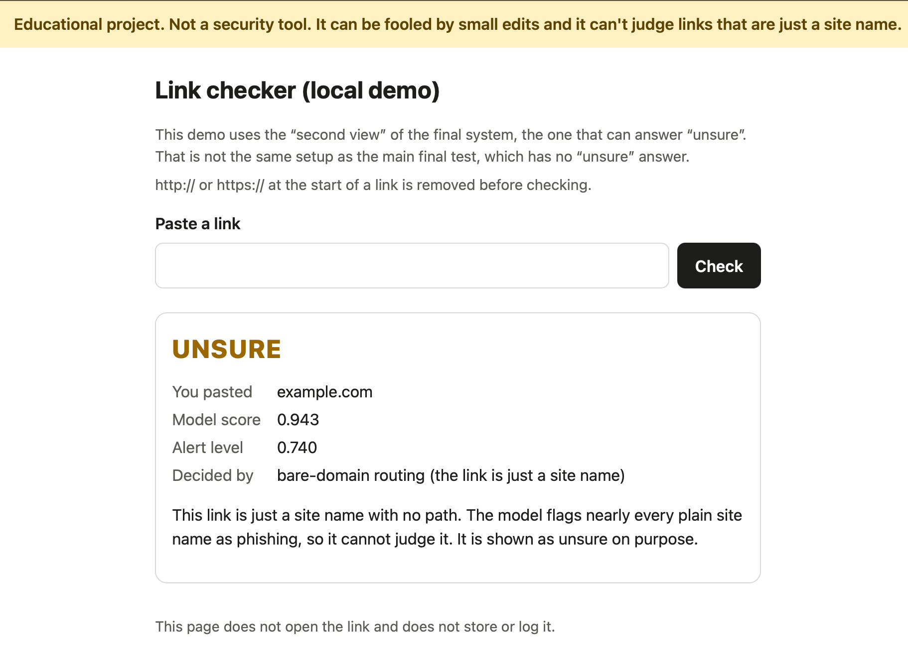
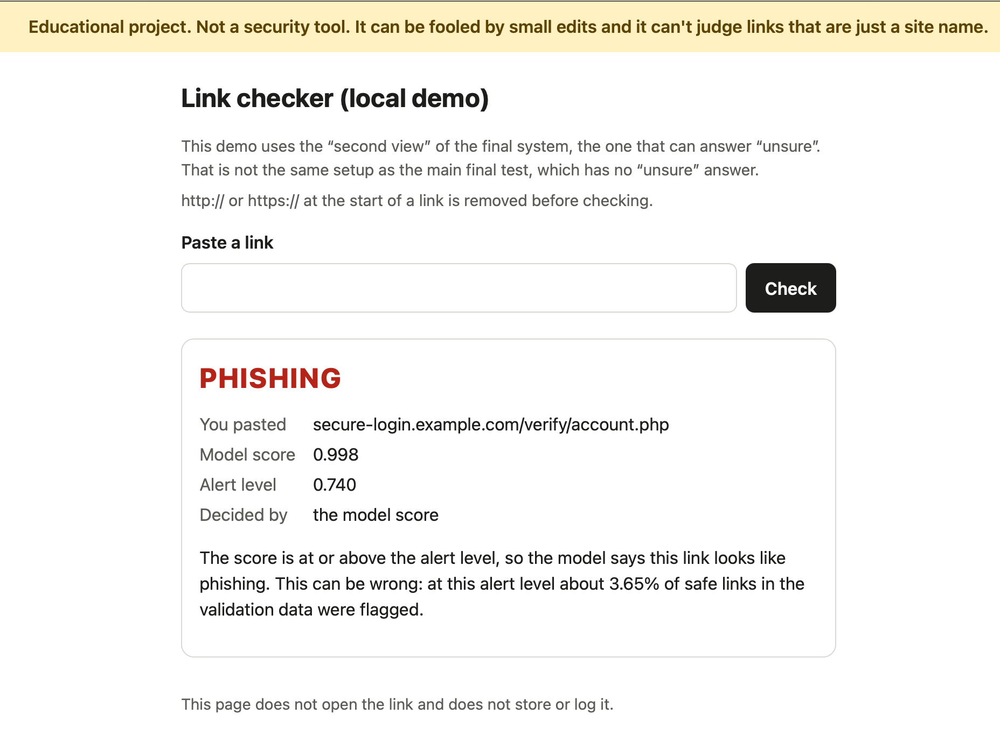
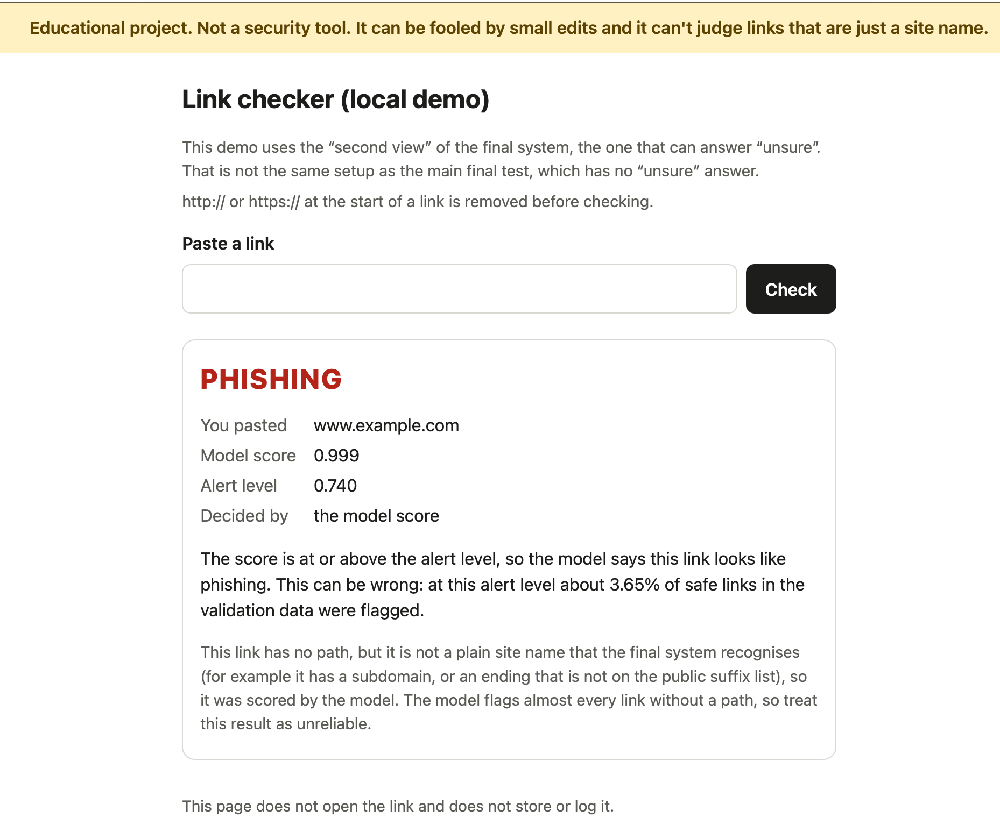
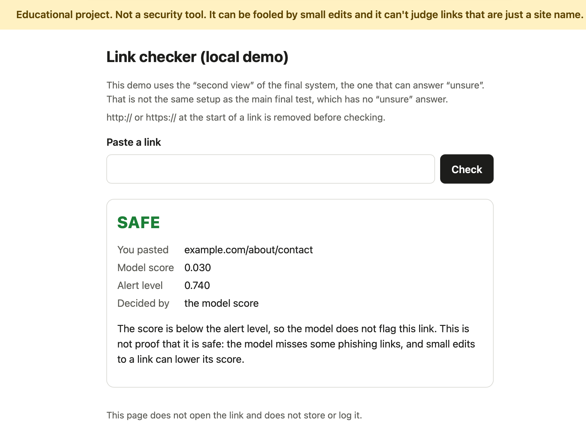

# Link checker (local demo)

A small page on your own computer. Paste a link, get a verdict (**phishing**, **safe** or **unsure**), the model score, the alert level, and which layer decided.

> Educational project. Not a security tool. It can be fooled by small edits and it can't judge links that are just a site name.

## Start it

From the repo root:

```bash
PYTHONHASHSEED=0 .venv/bin/python demo/app.py
```

Open **http://127.0.0.1:8000** in your browser. Use exactly that address: the page rejects `localhost` on purpose. Stop it with Ctrl-C. To use another port: add `--port 8001`.

## Which system is this?

It uses the **"second view"** of the final system: model 4a plus rule R1, plus the "unsure" answer (bare-domain routing and the uncertain-score band), exactly as saved in `results/final_system_config.json` (`second_view_abstain_classify_config`). This is **not the same setup as the main final test**, which has no "unsure" answer. So numbers from the final test do not describe what this page does. The page calls the project's own `defence_layers.classify`; it contains no scoring or rule logic of its own.

## What it does with a pasted link

- It reads the text only. It never opens, fetches or resolves the link, and makes no network calls while scoring.
- A leading `http://` or `https://` (any capitalisation) and surrounding spaces are removed before checking, because the training links had no scheme. Nothing else is changed (no lowercasing, `www.` stays). The result shows "Checked as" when something was removed.
- A link that is just a site name on the public suffix list (for example a plain `.com` name) gets "unsure" by bare-domain routing. Links with a subdomain and no path, or with an ending that is not on that list, are scored by the model, because that is what the final system does.

## Privacy and safety

- Listens on `127.0.0.1` only (there is no option to change that).
- Links are sent by POST, so they never appear in the address bar. Request logging is off, nothing is printed, nothing is written to disk.
- A browser may keep its own form history for the text box. The page cannot control that; clear it in your browser if you care.
- At start-up the page checks the SHA-256 of the model, the recipe and two code files against the config, and refuses to start if anything is missing or different.

## Check it

```bash
PYTHONHASHSEED=0 .venv/bin/python demo/check_demo.py
```

The check script uses made-up links only. It blocks the network while scoring (it never uses it), starts the server as a background process on this computer, tests it with local requests, then stops that one process and confirms the port is closed.

## What it does not do

No fetching of links, no page content, no HTTPS inspection, no outside services, no storage, no accounts. It is a classroom demo of one model and its defence layers.

## Examples

I used made-up links, so no real site is named. I picked these four to show the different answers the page can give. They are examples, not a test of how well the model works. The test results are in the main README.



`example.com` is a plain site name. The model's own score for it is 0.943, which is above the alert level, but the page says "unsure" on purpose, because the model flags nearly every plain site name.



`www.example.com` also has no path, but the "unsure" rule only recognises a plain site name written exactly, without `www.`. So the model scores it, and it gets flagged. I didn't change this, because the demo is meant to match the system I tested. The locked set had `www.` removed, so its numbers don't cover this case.



A phishing-style link. The model scores it 0.998.



A safe-looking link with a path. The model scores it 0.030 and passes it. That isn't proof it's safe, as the page says: the model misses some phishing links, and small edits can lower its score. In the few other links I tried while testing, links with a path on a normal `.com` ending tended to come out safe, and links without a path were flagged or "unsure". That's a handful of examples and not a measurement.

The model was trained on links without `http://` or `https://`, so the page removes them before checking. Without that step, one test link scored 0.843 instead of 0.805.
